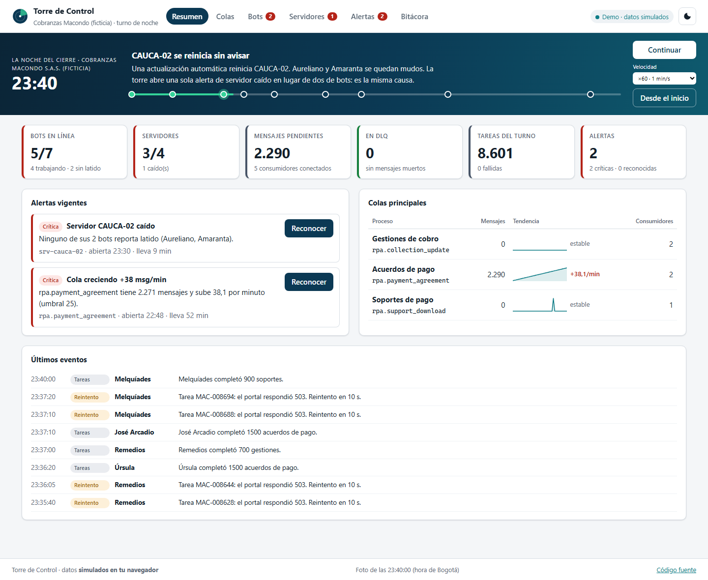
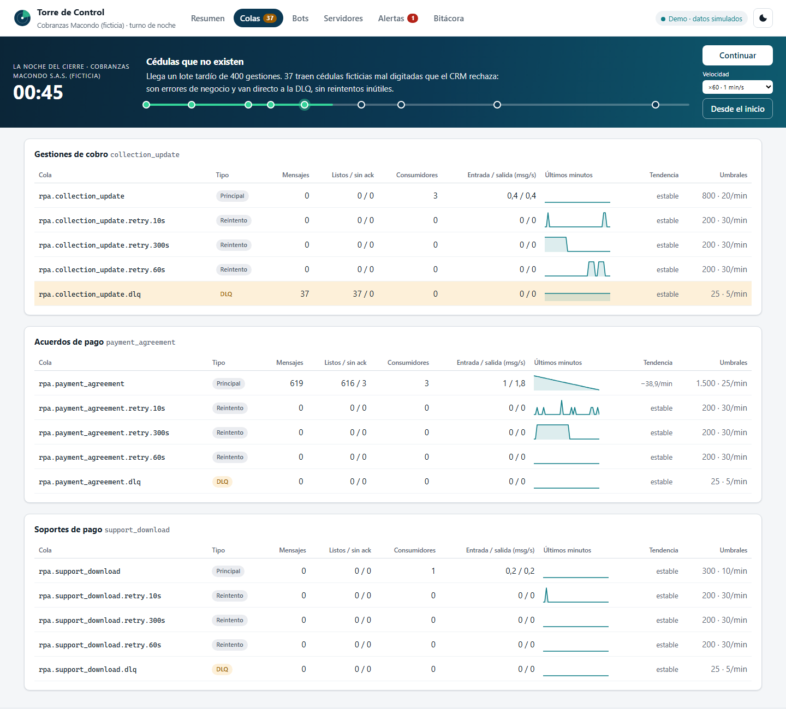
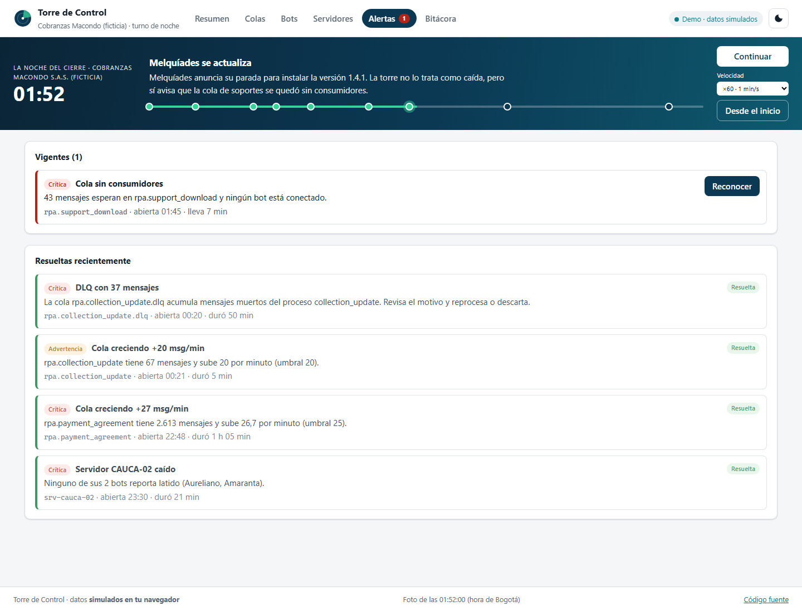
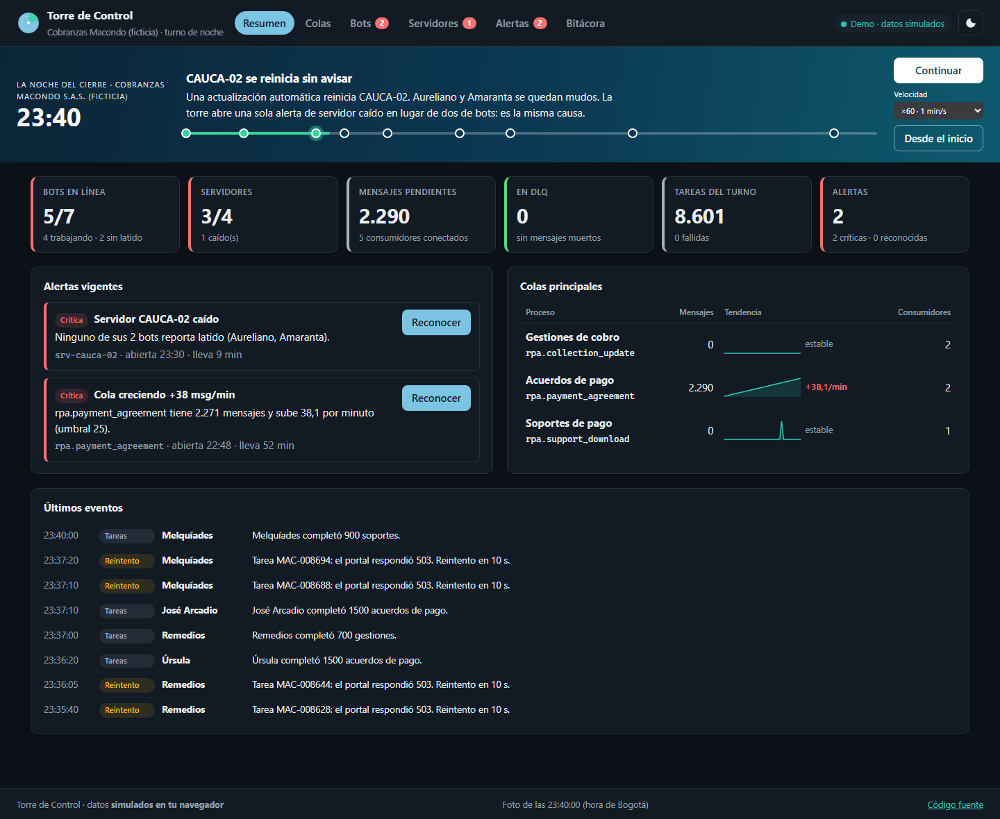
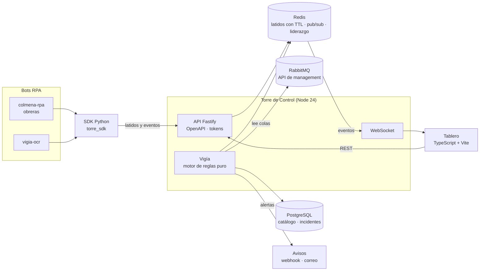

# 🗼 Torre de Control

[](https://github.com/DarwinMontiel/torre-de-control/actions/workflows/ci.yml)
[](https://darwinmontiel.github.io/torre-de-control/)


[](LICENSE)

**Monitoreo en tiempo real de bots RPA.** Lee las colas de RabbitMQ, cataloga servidores y bots,
recibe sus latidos y dispara alertas con escalamiento e inhibición: la cola que crece, la DLQ que
se llena, el bot que dejó de latir, el servidor que se cayó. API en **Fastify** documentada con
OpenAPI, estado vivo en **Redis**, historial en **PostgreSQL**, eventos al tablero por
**WebSocket** y un **SDK en Python** para que cualquier bot reporte.

**[Ver la demo en vivo →](https://darwinmontiel.github.io/torre-de-control/)** la torre completa corre en tu navegador, sin backend.



## La noche del cierre

> Es 30 de noviembre en **Cobranzas Macondo S.A.S.** Hay que registrar todos los acuerdos de pago
> del mes antes de las 6:00 a. m. **Rebeca**, la operadora del turno de noche, tiene siete bots en
> cuatro servidores y una pantalla: la Torre de Control.
>
> <sub>La empresa, el banco, las personas y los servidores son ficticios.</sub>

La demo reproduce esa noche capítulo por capítulo, y una prueba
([`noche-del-cierre.test.ts`](tests/dominio/noche-del-cierre.test.ts)) verifica que cada uno
dispare exactamente la alerta que la historia cuenta:

| Hora  | Qué pasa                                   | Qué hace la torre                                                                                    |
| ----- | ------------------------------------------ | ---------------------------------------------------------------------------------------------------- |
| 22:40 | El portal del banco se pone lento          | `cola_creciendo` como advertencia; **escala a crítica** cuando la cola pasa de 1.500                 |
| 23:30 | Un servidor Windows se reinicia sin avisar | Una sola alerta `servidor_caido`, que **inhibe** las de `bot_sin_latido`: misma causa, un solo aviso |
| 00:20 | Llegan 37 cédulas mal digitadas            | Errores de negocio directo a la DLQ: `dlq_con_mensajes`                                              |
| 01:45 | Un bot se detiene para actualizarse        | No es una caída, pero `cola_sin_consumidores` avisa que nadie atiende esa cola                       |
| 03:10 | Un navegador zombi cuelga a un bot         | `bot_sin_latido`; el servidor queda **degradado**, no caído                                          |

La historia completa está en [docs/historia.md](docs/historia.md).

| Colas                                                                                             | Alertas                                                                                       | Modo oscuro                                                                           |
| ------------------------------------------------------------------------------------------------- | --------------------------------------------------------------------------------------------- | ------------------------------------------------------------------------------------- |
|  |  |  |

## Arquitectura



| Decisión                                                               | ADR                                                             |
| ---------------------------------------------------------------------- | --------------------------------------------------------------- |
| TypeScript nativo en Node 24, sin paso de compilación para la API      | [0001](docs/adr/0001-typescript-nativo-en-node-24.md)           |
| Colas por la API de management de RabbitMQ: nunca toca un mensaje      | [0002](docs/adr/0002-rabbitmq-por-api-de-management.md)         |
| Redis para estado vivo; la hora del latido la pone la torre, no el bot | [0003](docs/adr/0003-redis-para-estado-vivo.md)                 |
| SQL explícito y migraciones con huella SHA-256                         | [0004](docs/adr/0004-sql-explicito-y-migraciones-con-huella.md) |
| Motor de alertas puro con identidad, escalamiento e inhibición         | [0005](docs/adr/0005-motor-de-reglas-puro.md)                   |
| Demo sin backend con el mismo dominio y un simulador determinista      | [0006](docs/adr/0006-demo-sin-backend.md)                       |
| Tablero sin framework y con escape por defecto                         | [0007](docs/adr/0007-tablero-sin-framework.md)                  |

Detalle en [docs/arquitectura.md](docs/arquitectura.md), incluidos los límites conocidos.

## Inicio rápido

Todo el sistema (API, tablero, PostgreSQL, Redis, RabbitMQ y siete bots simulados):

```bash
docker compose up --build -d
# Tablero:      http://localhost:8080
# API/OpenAPI:  http://localhost:3000/docs
# RabbitMQ:     http://localhost:15672
```

Solo el tablero en modo demo, sin servicios:

```bash
npm ci
npm run dev:demo
```

Reportar desde un bot en Python:

```python
from torre_sdk import ClienteTorre, ReportadorLatidos

torre = ClienteTorre("http://localhost:3000", token="...")
ReportadorLatidos(torre, bot_id="obrera-01", procesos=["payment_agreement"], version="2.0.0").iniciar()
```

Ejemplo completo en [`sdk/python/ejemplos/bot_minimo.py`](sdk/python/ejemplos/bot_minimo.py).

## Pruebas y calidad

| Comando                              | Qué cubre                                                                                |
| ------------------------------------ | ---------------------------------------------------------------------------------------- |
| `npm test`                           | 183 pruebas con Vitest: dominio, reglas, API (con dobles de Redis y PostgreSQL), tablero |
| `npm run test:cobertura`             | Cobertura con umbral (hoy ≈98 % de líneas)                                               |
| `npm run test:integracion`           | Contra PostgreSQL, Redis y RabbitMQ reales                                               |
| `npm run typecheck` · `npm run lint` | TypeScript estricto, ESLint y Prettier                                                   |
| `cd sdk/python && pytest`            | SDK de Python con ruff y mypy                                                            |

El CI corre todo lo anterior, la integración con servicios reales y la construcción de las
imágenes Docker. GitHub Pages publica la demo en cada cambio del tablero o del dominio.

## Qué demuestra / relación con mi experiencia

En una fintech de gestión de cartera construí una plataforma de monitoreo en tiempo real
(TypeScript, Fastify, PostgreSQL, Redis y Docker) que lee decenas de colas y cataloga servidores y
bots. Este repositorio es una versión propia, más pequeña y pública de esa idea, con datos
ficticios. Vigila las colas de [colmena-rpa](https://github.com/DarwinMontiel/colmena-rpa) usando
sus mismas convenciones de nombres y puede recibir latidos de
[vigia-ocr](https://github.com/DarwinMontiel/vigia-ocr).

## Estructura

```
src/
├── dominio/   # reglas de alertas, salud, tendencias, simulador e historia (sin E/S)
├── api/       # Fastify: rutas, esquemas TypeBox, vigía y adaptadores (Redis, PostgreSQL, RabbitMQ)
└── tablero/   # vistas, gráficos SVG y modo demo
sdk/python/    # torre_sdk: cliente y reportador de latidos
simulador/     # siete bots simulados para docker compose
```

## Licencia

[MIT](LICENSE) · Hecho por [Darwin Montiel Mora](https://darwinmontiel.github.io).
