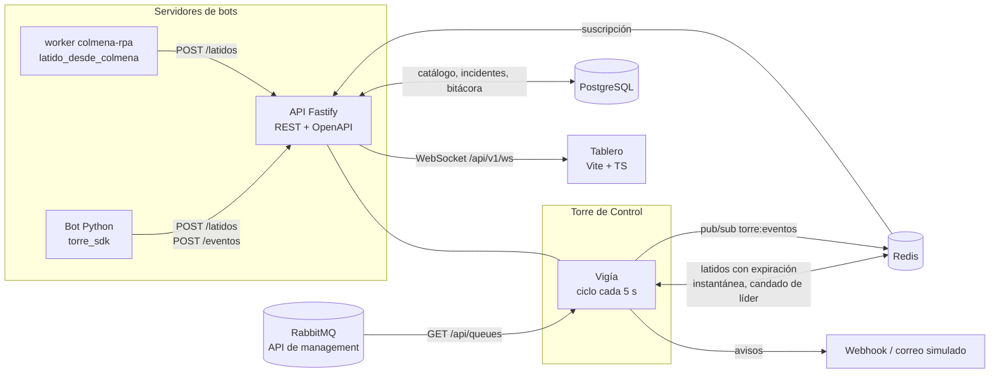
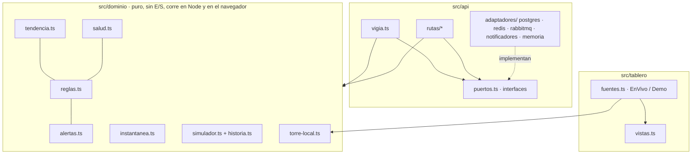

# Arquitectura

## Vista general



La torre es una sola aplicación Node con dos papeles:

1. **API** (todas las réplicas): recibe latidos y eventos de los bots, administra el catálogo,
   expone alertas y reparte por WebSocket lo que llega por pub/sub de Redis.
2. **Vigía** (solo la réplica que tiene el candado de líder en Redis): cada `TORRE_INTERVALO_VIGIA_MS`
   lee las colas, evalúa las reglas, concilia alertas, envía avisos y publica la instantánea.

## Capas



- **Dominio**: funciones puras. `evaluarReglas` recibe la foto del mundo y devuelve hallazgos;
  `conciliarAlertas` decide qué se abre, escala, actualiza o resuelve; `construirInstantanea`
  arma lo que pinta el tablero. Nada de esto sabe de HTTP, SQL ni Redis.
- **Puertos y adaptadores**: cada dependencia externa es una interfaz con dos implementaciones,
  una real y una en memoria. La batería de [pruebas de contrato](../tests/api/contratos.test.ts)
  corre igual contra memoria y contra PostgreSQL (pg-mem con las migraciones reales).
- **Tablero**: vistas puras `Instantanea → Html`. La fuente de datos decide si la foto viene del
  WebSocket o de la torre local que corre en el navegador (demo).

## Del latido a la alerta

```mermaid
sequenceDiagram
    autonumber
    participant Bot as Bot (torre_sdk)
    participant API as API
    participant R as Redis
    participant V as Vigía (líder)
    participant PG as PostgreSQL
    participant T as Tablero
    Bot->>API: POST /latidos {estado: BUSY, tareaActual}
    API->>R: SET torre:latido:bot-x (EX retención)
    Note over Bot: el servidor se reinicia; no hay más latidos
    loop cada 5 s
        V->>R: tomar liderazgo (SET NX PX)
        V->>V: leer colas (RabbitMQ) + historial de tendencia
        V->>R: últimos latidos
        V->>V: evaluarReglas → hallazgo servidor_caido
        V->>PG: vigentes() / guardar(abiertas, resueltas…)
        V->>V: avisos (webhook, correo)
        V->>R: PUBLISH torre:eventos {alerta abierta}, {instantánea}
        R-->>API: mensaje
        API-->>T: WebSocket
    end
```

## Decisiones clave

| Tema         | Decisión                                                           | ADR                                                        |
| ------------ | ------------------------------------------------------------------ | ---------------------------------------------------------- |
| Ejecución    | TypeScript nativo en Node 24, sin compilar                         | [0001](adr/0001-typescript-nativo-en-node-24.md)           |
| Colas        | API de management de RabbitMQ, no AMQP                             | [0002](adr/0002-rabbitmq-por-api-de-management.md)         |
| Estado vivo  | Redis para latidos, pub/sub y liderazgo; el reloj lo pone la torre | [0003](adr/0003-redis-para-estado-vivo.md)                 |
| Persistencia | SQL explícito y migrador con huellas, sin ORM                      | [0004](adr/0004-sql-explicito-y-migraciones-con-huella.md) |
| Alertas      | Motor puro con identidad, escalamiento e inhibición                | [0005](adr/0005-motor-de-reglas-puro.md)                   |
| Demo         | La misma torre en el navegador sobre un simulador determinista     | [0006](adr/0006-demo-sin-backend.md)                       |
| Tablero      | TypeScript sin framework, plantillas que escapan por defecto       | [0007](adr/0007-tablero-sin-framework.md)                  |

## Límites conocidos

- El historial de tendencia vive en memoria del líder: si el líder cambia, la regla
  `cola_creciendo` espera `TORRE_COBERTURA_MINIMA_MIN` antes de volver a opinar.
- La renovación del candado de líder no es atómica (SET NX + GET + PEXPIRE). Con un TTL de tres
  ciclos el peor caso es un ciclo duplicado; el índice único parcial de `incidentes` impide que
  eso abra dos alertas iguales.
- El reconocimiento de alertas no exige autenticación de usuario (ver [SECURITY.md](../SECURITY.md)).
